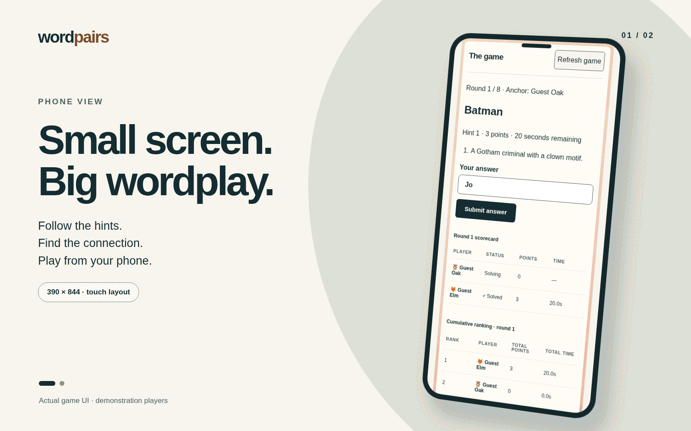

# Wordpairs

<picture>
  <source media="(prefers-reduced-motion: reduce)" srcset="docs/images/readme/wordpairs-desktop-perspective.png">
  
</picture>

Actual game UI with demonstration players. Slides alternate every seven seconds.

[Phone view](docs/images/readme/wordpairs-phone-perspective.png) · [Desktop view](docs/images/readme/wordpairs-desktop-perspective.png) · [Capture details](docs/images/readme/capture-receipt.json)

Wordpairs is a real-time word-association game. Its [requirements](docs/word_association_game_requirements.md), [AC gap analysis](docs/ac_gap_analysis.md), [test execution receipt](docs/test_execution_receipt.jsonl), [planned AC test inventory](docs/ac_test_inventory.md), [repo review receipt](docs/repo_review_receipt.jsonl), [implementation plan](docs/implementation_plan.md), [Phase 1A execution record](docs/phase1a_execution.md), [Phase 0–6 hostile-validation goal](docs/goal_hv_agreement_through_phase_6.md), [Phase 0 execution tracker](docs/implementation_phase0_execution.md), [Phase 0 interface and data contracts](docs/phase0_interface_and_data_contracts.md), [Phase 0 approval receipt](docs/phase0_approval_receipt.jsonl), [Phase 0 refresh review receipt](docs/phase0_refresh_hostile_review_receipt.jsonl), [implementation kickoff review receipt](docs/implementation_kickoff_receipt.jsonl), [approved architecture decision record](docs/architecture_decision_record.md), [architecture design and FR/TR traceability](docs/architecture_design.md), [architecture patterns](docs/architecture_patterns.md), [deployment plan](docs/deployment_plan.md), [moderation plan](docs/moderation_plan.md), and rendered diagrams are in `docs/`.

## Project status

Phases 0–6 completed implementation and independent phase-exit review, including multiplayer gameplay, moderation and final acceptance. Historical evidence remains in the [Phase 6 execution record](docs/phase6_execution.md). The [administration and ACL extension](docs/admin_acl_design.md) adds dedicated moderation, word/hint editing and role-management pages, with its own validation. Hosted deployment remains Phase 7; a locally running app is not a hosted release.

## Local setup and validation

The application uses Next.js 16.4.3, React 19.3.1 and TypeScript 6.0.3, pinned in `package.json` and `package-lock.json`. Install dependencies with `npm ci`, configure the server environment and a migrated TLS-enabled database as described in [local development](docs/local_development.md), then run `npm run dev -- --hostname 127.0.0.1 --port 3000`. Open the exact origin configured in `WORDPAIRS_ORIGIN`.

The [testing guide](docs/testing.md) lists unit, PostgreSQL, multiplayer, administration, Realtime and browser commands and their evidence boundaries. The administration candidate passed 502 unit/contract tests, 66 PostgreSQL tests and 31 browser journeys, plus the production build. Its [independent hostile review](docs/admin_acl_review_receipt.json) approved the recorded [189-file snapshot](docs/admin_acl_review_manifest.json) at 99/100 for accuracy and completeness with no unresolved findings. This documentation refresh follows that snapshot and does not relabel it as a review of later bytes.

The [wiki manifest](docs/wiki.yaml) indexes current guides and historical execution records. MCP trust and logging were restored by registering this repository and correcting the service configuration file's ACL mask. The [maintenance receipt](docs/maintenance_receipt.json) records the recovery, triage reports and requirements-export outcome.

## Install on your phone

Wordpairs supports home-screen installation and opens in a standalone window at `/play`. Open the **HTTPS** game address on your phone. On Android, use **Install Wordpairs** when your browser offers it, or its **Install app / Add to Home screen** menu. On iPhone, open Safari → **Share → Add to Home Screen** and keep **Open as Web App** enabled if offered. The page also includes **Get Wordpairs on your phone** instructions.

Multiplayer needs a connection. An installed app opened offline shows a reconnect screen; the service worker stores only that static screen and public icons. Sessions, rooms, answers and admin data are never placed in its cache. A plain HTTP LAN address cannot provide the same secure installation support; localhost is a development exception. See the [PWA design and verification](docs/pwa_design.md).

## Administration

The administration pages are `/admin` (moderation queue and curation), `/admin/words` (word pairs, answers, alternatives and three hints), and `/admin/users` (role assignment and audit history). Moderators manage content; senior moderators also resolve independent appeals; administrators additionally manage user access.

Set the server-only `WORDPAIRS_ADMIN_PROFILE_IDS` variable to comma-separated existing profile IDs, then restart the server. Find your ID under **Profile details** in the signed-in/guest profile panel. Configured administrators cannot have that authority revoked in the UI. There is no default admin account, password or public bootstrap endpoint. Use a durable signed-in profile for operational access. Apply `src/infrastructure/migrations/010_access_control.sql` to an existing database before using user administration; new test databases apply it automatically.

Edits create immutable pair versions for future rounds; current games retain their original words and hints. See the [admin/ACL design](docs/admin_acl_design.md). Run the focused PostgreSQL checks with `npm run test:admin`.

## Multiplayer integration tests

Run `npm run test:multiplayer` with Docker, PowerShell 7, and installed npm dependencies. The runner creates a disposable, loopback-only PostgreSQL container, applies every migration, and removes the container in `finally`. It does not use the running game's database.

The suite plays eight-round games at every size from 2 through 25 players (24 games, 324 player participations). It exercises real identity, room, lobby, match, and PostgreSQL services, including simultaneous answer conflicts and retries, all hint/scoring stages, shared final standings, and exactly-once profile awards. Time and random draws are controlled; browser UI and Realtime transport remain covered by their separate suites. The full `tests/integration/run-phase1.ps1` run also includes this suite.

## License

The game is intended to use GNU GPL version 2 only (`GPL-2.0-only`). See [`LICENSE`](LICENSE).

## Deployment target

The application target is Vercel from `sharpninja/wordpairs`. Coding Phases 1–6 precede all Phase 7 deployment and release work.

## Live multiplayer runtime

Live gameplay needs authenticated Realtime configuration and an independent deadline/outbox worker. A rendered page alone does not establish a working game. See [local live setup](docs/local_development.md) and [real browser integration](docs/room_sync_fix.md). `npm run test:live-ui` targets an explicitly configured real runtime and complements the service integration suite.

For a repeatable local browser matrix, run `pwsh -NoProfile -File scripts/run-local-ui-integration.ps1` after a production build. It uses installed Chromium, owned disposable TLS databases on volatile test storage, private Realtime and loopback HTTPS, then cleans up only its owned resources. It does not establish disk durability or public capacity. See [the UI harness guide](docs/testing.md#disposable-loopback-https-ui-harness).

## UI workflow and recovery extension

Moderation now supports reasoned change requests with proposer-only resubmission, and nomination holds with reasoned resume. Profile editing has explicit Save/Cancel; content/editor drafts survive authorized in-tab navigation, and uncertain writes retain their original commands. No-solver rounds advance automatically after a3-second server delay. Discovery seat losses return to a fresh board while direct links retain observation. Existing databases need migration011 as well as earlier migrations. See the [implementation, repeatable UI tests and QBrain traceability](docs/testing/ui/implementation.md).

Contest readiness and all historical hostile-validation evidence are tracked in [the submission checklist](docs/submission/README.md). The official cutoff is earlier than the public marketing date; final public/live evidence and entrant prerequisites remain explicit.
