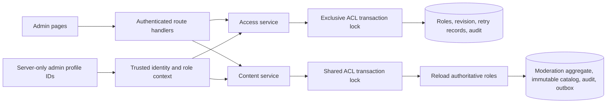

# Administration and access control

Implementation extension requested 27 October 2026, after the completed Phase 0–6 baseline. Historical phase approvals remain historical evidence; this extension receives its own hostile validation.

## Screens and operations

`/admin` provides a searchable moderation queue with pending, appealed, approved and completed filters, reasoned approval/rejection, independent appeal resolution, complete curation forms and decision history. `/admin/words` provides category/search filters, pair creation and editing (prompt, target, accepted alternatives and exactly three ordered hints), and exclusion from future rounds with a reason. `/admin/users` provides profile search, current roles, audited grants/revocations and role history. Ordinary players receive an access-denied state; private data is never fetched through an unrestricted admin endpoint.

## Permissions

| Role | Moderate and curate | Author/edit pairs and hints | Resolve appeals | Assign/revoke roles |
|---|---|---|---|---|
| Player | No | No | No | No |
| Moderator | Yes | Yes | No | No |
| Senior moderator | Yes | Yes | Yes | No |
| Administrator | Yes | Yes | Yes | Yes |

Appeal reviewers must remain independent of the proposer and original reviewer, even when they are administrators. Roles are additive; revoking one role does not revoke another role's permissions. The default player role cannot be assigned or removed. There is no browser-side self-grant or public administrator-bootstrap endpoint.

## Server configuration and identity

`WORDPAIRS_ADMIN_PROFILE_IDS` is a server-only comma-separated list of existing, stable profile IDs. It is never exposed as a public environment variable or accepted in HTTP input. The authenticated profile screen displays the current profile ID so an operator can configure the first administrator. Configured administrators receive the admin role in trusted identity/content composition and SQL access checks; the entire allowlist is never returned to a client. Their administrator permission cannot be revoked through the UI. Changing the allowlist requires restarting/redeploying the server. Other administrator and moderator grants persist in PostgreSQL and are reloaded on every authenticated request.

## Transaction boundaries

The ACL has a singleton revision and a dedicated serialized change transaction. Only a current administrator can read the user directory or change roles. A role change validates the target profile, role, grant/revoke intent, reason, command ID, digest and expected ACL revision; it atomically writes the role, revision, canonical retry result and append-only audit record. Changed command digests and stale revisions reject. Removing the final effective administrator is rejected, considering configured administrators whose profiles exist. Concurrent cross-revocations serialize so they cannot remove every administrator. Revoked actors cannot use old ACL commands to regain authority.

ACL mutations take an exclusive advisory transaction lock; privileged content mutations take the corresponding shared lock before loading authoritative roles. This establishes a single order for content writes racing with revocation. Content then follows the existing room/match/moderation/catalog lock order. Revocation denies new privileged commands; an exact replay of an already committed content command retains its existing mutation-free canonical response.

Database functions are executable only by `service_role`. ACL tables have RLS enabled and deny browser roles, and privileged changes never depend on roles, wins or actor IDs supplied by the client. HTTP mutation routes require the canonical same-origin checks, a valid session, expected profile binding, strict field allowlists and no-store responses. Search results are bounded and include only profile ID, generated alias, identity kind and effective roles; they exclude credentials, email and OIDC subjects.

## Catalog integrity

Edits append the next immutable version of an existing pair; creation uses a new ID at version zero. Existing pair IDs cannot move between categories. All saves require a reason, valid approved category/background, bounded plain text, accepted alternatives and exactly three hints. The existing moderation aggregate serializes publication, audits, exclusions and catalog-revision invalidation in one database transaction. New records flow through the existing catalog projection trigger.

Community activation creates only previously unused pair IDs at version zero. It cannot reuse an existing pair ID in another category or skip versions; revisions belong to the editorial save path.

Active rounds continue using their original pair ID and version. Future pools choose the highest version per pair ID and include it only if that version is selectable; excluding it never falls back to an older version. Exclusion preserves historical records and cannot empty an initial category. A revised excluded pair is a new selectable version; older exclusions remain in history. Direct editorial authoring is a privileged, audited operation; community proposals continue through the existing independent review and activation workflow and cannot have their status silently overridden. There is no destructive delete operation.

The existing catalog ceiling counts every approved historical pair version. Under the serialized moderation transaction, both direct saves and community activations must check the projected total before publishing: adding beyond 4096 versions returns `SERVICE_LIMIT` without state, audit, revision or idempotency writes. This includes editing an existing pair at the ceiling. A rejected edit leaves historical lookups and active games available.

## Validation

Pure policy and transport tests cover permission inheritance, configured administrators, input/identity/origin forgery, content revisions and invalid hints. Real PostgreSQL tests cover role grants, revocations, idempotency, concurrent final-administrator removal, role changes racing with content, audit atomicity, browser-role denial, immutable old content and new-round selection. Browser tests exercise ordinary-player denial, administrator role management, moderation, editable word/hint forms, uncertain retry and phone layout. Existing unit, integration, browser, type, lint and production-build checks remain applicable. Independent hostile review examines the design and the exact final change/evidence, and records unresolved findings rather than inventing user sign-off gates.

## UI workflow extension

The [UI implementation design and evidence](testing/ui/implementation.md) extends the existing authority and immutable-catalog boundary with reasoned changes_requested/resubmit and on_hold/resume transitions. Migration011 retains legacy pending records while adding pending_review and extending the one-open-suggestion index. The proposer-only revision path never bypasses independent review, curation or the rejection appeal policy. Actor, prior/new proposal, case version, reason and status are committed in the same audit transaction.

Tab-local drafts, verified session generations, native profile Save/Cancel/Escape, canonical uncertain-command retention and acknowledged success results now survive authorized in-tab navigation. Authorization denial invalidates older reads before private data can return. The existing live room transport remains separately verified; fixture browser UI evidence does not establish the full real private-push player-count matrix.
