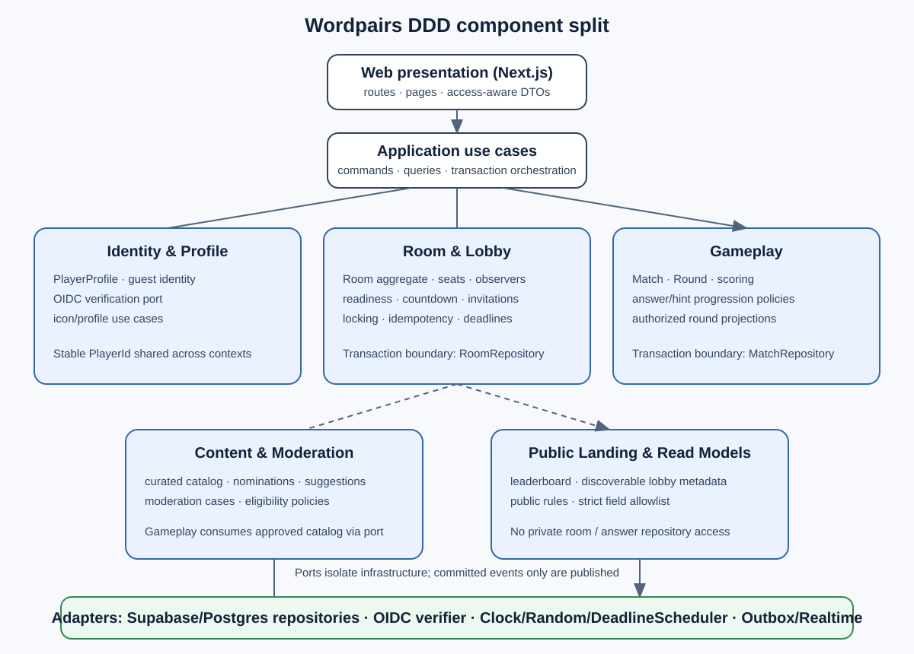
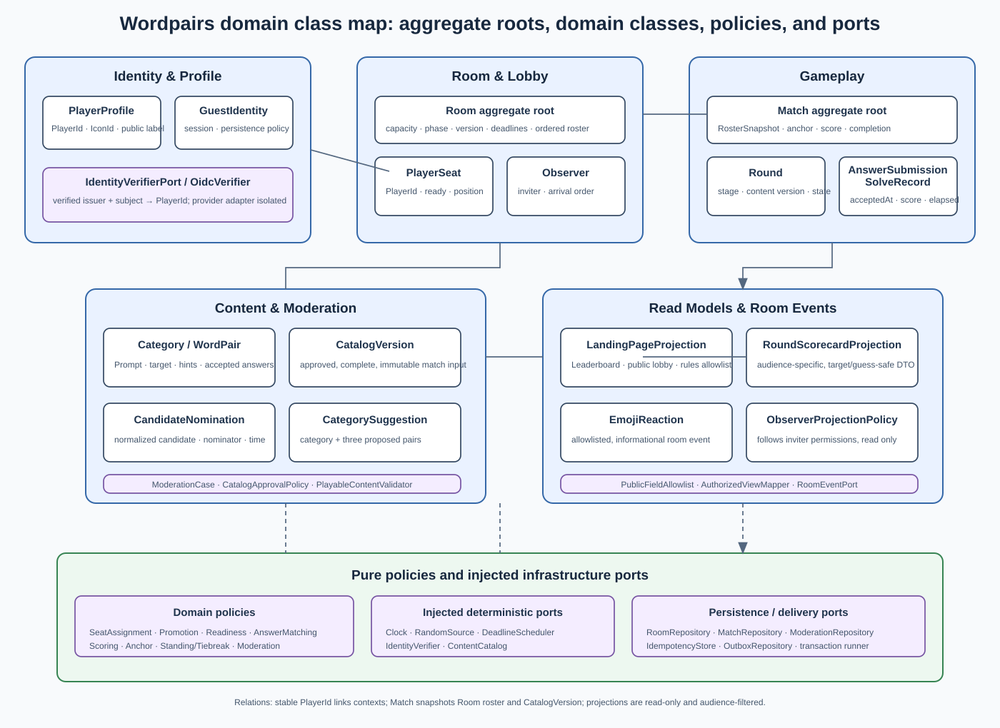
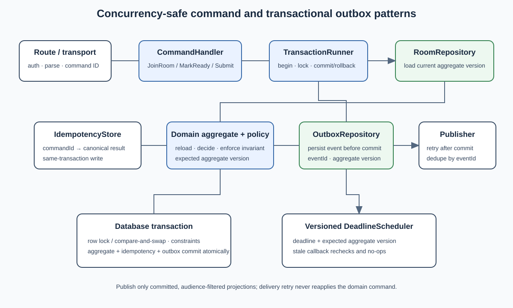

# Wordpairs Architecture Design

**Requirements traceability, DDD component split, and design-pattern class views**  
Version 1.0 · 26 October 2026 · Derived from Requirements v2.4

This document maps every functional requirement (FR-01–FR-22) and technical requirement (TR-01–TR-31) to the proposed bounded contexts, application components, and logical classes. Names below describe responsibilities, not mandatory programming-language syntax. The selected deployment and persistence requirements are Vercel and Supabase/Postgres (TR-20–TR-24). The architecture proposes a modular monolith using Next.js/TypeScript, pending approval of the architecture decision record before implementation. The diagrams are SVG assets embedded here.

## Architecture rules

- Domain policies contain each business rule once and import no Next.js, React, Supabase, or transport code.
- Application use cases orchestrate domain decisions and ports; route handlers validate/translate transport input and call use cases.
- A room aggregate is the serialization boundary for membership, readiness, countdown, and roster state. A match/round aggregate owns answer progression and scoring.
- Repository transactions, unique/check constraints, row locking or compare-and-swap, idempotency, and transactional outbox writes protect concurrent commands.
- Realtime is delivery, not authority. Clients render authorized projections and may retry with the same command ID.
- Read projections have explicit field allowlists for players, observers, moderators, and the public landing page.
- Clock, randomness, identity verification, deadline scheduling, storage, and event delivery are ports, so domain and use-case tests can use deterministic fakes.

## DDD component diagram

The component view places identity, room/lobby, gameplay, content/moderation, and public read models behind the application boundary. The domain class map shows representative core classes and their relationships in each context, including identity, catalog/moderation, reactions, and public/player projections. The traceability tables below are the complete requirement-to-class index; the class diagrams show the design-pattern structures and principal relationships rather than repeating every class name from every row. The room and game contexts are separate domain modules with their own aggregates and repositories. Shared identity is referenced by stable `PlayerId` values. Content review produces approved catalog records consumed by gameplay through a read-only catalog port. The public landing context reads curated projections and cannot query private room or answer state.

## Design-pattern class diagrams

### Cross-context domain class map and policy strategies

The diagram includes central classes from Identity & Profile, Room & Lobby, Gameplay, Content & Moderation, and Read Models/Room Events, along with pure policies and infrastructure ports. Policy interfaces isolate choices that must remain configurable or unresolved, such as answer matching, match length, tiebreak treatment, and public leaderboard contract. Domain rules do not depend on persistence.

### Transactional command, idempotency, and outbox patterns

The command path validates the command key, locks/reloads the aggregate in one transaction, applies one domain decision, saves the new version and idempotency result, and writes an outbox event before commit. A versioned deadline command makes stale timer callbacks harmless. Outbox delivery retries by event ID and cannot reapply a command.

## FR to DDD and class traceability

| Requirement | Bounded context / application component | Primary logical classes and responsibilities |
|---|---|---|
| FR-01 Room access | Identity & Profile; Room & Lobby | `CreateRoom`, `JoinRoom`, `QuickMatch`, `Room`, `RoomCapacity`, `RoomCode`, `SeatAssignmentPolicy` |
| FR-02 Player profile | Identity & Profile | `PlayerProfile`, `PlayerId`, `IconId`, `UpdateProfile` |
| FR-03 Lobby | Room & Lobby | `Room`, `PlayerSeat`, `Observer`, `LobbyProjection`, `RoomInvite` |
| FR-04 Predefined content | Content & Moderation; Gameplay | `WordPair`, `Category`, `HintSet`, `AcceptedAnswerSet`, `CatalogRepository` |
| FR-05 Relationship categories | Content & Moderation | `Category`, `CategoryId`, `WordPair` |
| FR-06 Category backgrounds | Content & Moderation; Presentation adapter | `CategoryBackground`, `AssetReference`, `CategoryCatalog` |
| FR-07 Category selection | Gameplay | `StartMatch`, `Match`, `AnchorAssignmentPolicy`, `RandomSource`, `CategorySelection` |
| FR-08 Answer stages | Gameplay | `Round`, `HintStage`, `SubmitAnswer`, `RoundProgressionPolicy`, `HintAudiencePolicy` |
| FR-09 Scoring | Gameplay | `ScoringPolicy`, `ScoreAward`, `HintStage`, `PlayerRoundResult` |
| FR-10 Score lock and elapsed time | Gameplay | `Round`, `SolveRecord`, `ElapsedTime`, `Clock` |
| FR-11 Live round scorecard | Gameplay; Read projections | `RoundScorecardProjection`, `PlayerRoundResult`, `AuthorizedViewMapper` |
| FR-12 Round reveal | Gameplay | `RevealRound`, `Round`, `RoundRevealProjection`, `TargetAnswer` |
| FR-13 Round summary | Gameplay; Read projections | `RoundSummaryProjection`, `MatchStanding`, `Score` |
| FR-14 Game end and tiebreak | Gameplay | `CompleteMatch`, `Match`, `MatchLengthPolicy`, `StandingPolicy`, `TiebreakPolicy` |
| FR-15 Responsive screens | Web Presentation | `ProfilePage`, `LobbyPage`, `RoundPage`, `ScorecardView`, responsive UI components; server-side rules remain in domain/use cases |
| FR-16 Future answer nominations | Content & Moderation | `NominateCandidate`, `CandidateNomination`, `NominationThresholdPolicy`, `ModerationCase` |
| FR-17 Category and pair suggestions | Content & Moderation | `SubmitCategorySuggestion`, `CategorySuggestion`, `WinEligibilityPolicy`, `ModerationCase`, `CatalogApprovalPolicy` |
| FR-18 Identity modes | Identity & Profile | `AuthenticateWithOidc`, `ContinueAsGuest`, `IdentityProviderPort`, `OidcVerifier`, `GuestIdentity`, `PlayerProfile` |
| FR-19 Lobby discovery and matching | Room & Lobby | `BrowseLobbies`, `QuickMatch`, `JoinRoom`, `Room`, `ObserverPromotionPolicy`, `ReadinessPolicy`, `DeadlineScheduler` |
| FR-20 Full-room observer mode | Room & Lobby | `JoinAsObserver`, `Observer`, `FollowedPlayerId`, `ObserverPromotionPolicy`, `Room` |
| FR-21 Emoji reactions | Gameplay; Realtime adapter | `PublishReaction`, `EmojiReaction`, `ReactionAllowlist`, `RoomEventPort` |
| FR-22 Public landing page | Public Landing; Read projections | `LandingPageProjection`, `LeaderboardProjection`, `PublicLobbyProjection`, `PublicFieldAllowlist`, `GameplayRulesContent` |

## TR to components, patterns, and classes

| Requirement | Component / pattern | Primary logical classes, ports, and safeguards |
|---|---|---|
| TR-01 Authoritative room state | Room & Lobby and Gameplay / aggregate roots | `Room` and `Match`/`Round` aggregates; `RoomRepository` and `MatchRepository`; server-side room/game command handlers |
| TR-02 Real-time synchronization | Realtime delivery / outbox | `OutboxEvent`, `OutboxPublisher`, `RoomEventPort`, authorized projection mappers |
| TR-03 Submission ordering | Gameplay / deterministic domain service | `SubmitAnswer`, `AcceptedSubmission`, `AcceptanceSequence`, `SubmissionOrderingPolicy`, `Clock` |
| TR-04 Answer validation | Gameplay / strategy policy | `AnswerMatchingPolicy`, `AcceptedAnswerSet`, `NormalizeAnswer`, `SubmitAnswer` |
| TR-05 Answer confidentiality | Gameplay / audience-specific projection | `HintAudiencePolicy`, `RoundProjectionMapper`, `RoundRevealProjection`, `TargetAnswer` visibility guard |
| TR-06 Curated content integrity | Content & Moderation / invariant | `WordPair`, `Category`, `CatalogApprovalPolicy`, `PlayableContentValidator`, DB constraints |
| TR-07 Background rendering | Content & Presentation adapter | `CategoryBackground`, `AssetReference`, contrast overlay and fallback renderer |
| TR-08 Clock consistency | Shared ports / authoritative time | `Clock`, `RoundStartedAt`, `AcceptedAt`, `ElapsedTime` |
| TR-09 Connection handling | Realtime / retry-safe commands | `CommandId`, `IdempotencyStore`, `ReconnectRoom`, `RoomSnapshotProjection`, `ConnectionPolicy` |
| TR-10 Room code handling | Room & Lobby / transaction boundary | `RoomCode`, `JoinRoom`, `RoomCapacity`, `RoomRepository`, `SeatAssignmentPolicy` |
| TR-11 Mobile input | Web Presentation | Accessible responsive controls; `RoundPage`; adapter-independent command API |
| TR-12 Accessibility and readability | Web Presentation | Accessible component set, semantic status labels, focus management, contrast validation |
| TR-13 Anchor assignment | Gameplay / injected randomness | `StartMatch`, `AnchorAssignmentPolicy`, `RandomSource`, immutable `RosterSnapshot` |
| TR-14 Candidate nomination and moderation | Content & Moderation | `CandidateNomination`, `NominationThresholdPolicy`, `ModerationCase`, `NominationRepository` |
| TR-15 Category suggestion eligibility and review | Content & Moderation | `WinEligibilityPolicy`, `CategorySuggestion`, `ModerationCase`, `CatalogApprovalPolicy` |
| TR-16 Identity and authentication | Identity & Profile / adapter | `IdentityProviderPort`, `OidcVerifier`, `GuestIdentity`, `PlayerProfileRepository`, token-validation policy |
| TR-17 Lobby discovery and matching | Room & Lobby / serialized assignment | `BrowseLobbies`, `QuickMatch`, `JoinRoom`, `RoomRepository`, transaction and capacity constraints |
| TR-18 Observer perspective and permissions | Room & Lobby / authorization projection | `Observer`, `FollowedPlayerId`, `ObserverProjectionPolicy`, read-only command authorization |
| TR-19 Emoji reaction delivery | Gameplay / allowlisted event | `EmojiReaction`, `ReactionAllowlist`, `RoomEventPort`, event audience mapper |
| TR-20 Vercel deployment target | Deployment adapter / platform configuration | Vercel Git integration, Preview/Production environment mapping, build artifact manifest |
| TR-21 Free-tier operation | Infrastructure boundary | `DeploymentConfig`, resource-budget checks, approved service allowlist; no paid add-ons |
| TR-22 Persistence and real-time room state | Persistence and Realtime adapters | `SupabaseRoomRepository`, `SupabaseMatchRepository`, Postgres, `RoomEventPort` |
| TR-23 Provisioning and schema changes | Operations adapter | `ProvisioningCommand`, migration runner, environment configurator, safe rerun/idempotency checks |
| TR-24 GitHub Actions availability | Deployment workflow | Vercel Git integration; manually invoked authenticated provisioning; no Actions dependency |
| TR-25 Direct dependencies and attribution | Build / supply-chain component | `package.json`, lockfile, `AttributionManifest`, `docs/ATTRIBUTIONS.md` |
| TR-26 Mock-first test gate | Test architecture | `DomainPolicyTests`, `UseCasePortFakes`, mocked test gate; production build test gate |
| TR-27 Per-build software bill of materials | Build / artifact generation | `CycloneDxGenerator`, `Lockfile`, `BuildCommit`, `SwbomArtifact`, deployment verification |
| TR-28 SWBOM in release archive | Release packaging | `ReleasePackager`, `SwbomArtifact`, commit/build identity verifier, archive manifest |
| TR-29 Project license | Release packaging / legal metadata | `LicenseArtifact`, `GPL-2.0-only` metadata, third-party attribution inclusion |
| TR-30 Public landing data boundary | Public Landing / CQRS-lite projection | `LandingPageProjection`, public query port, `PublicFieldAllowlist`, no private repository exposure |
| TR-31 Testable domain and concurrency boundaries | Modular monolith / ports-and-adapters, aggregate transaction, idempotency, outbox | `RoomCommandHandler`, `TransactionRunner`, `RoomRepository`, `IdempotencyStore`, `OutboxRepository`, pure policies |

## Pattern selection and application

| Pattern | Application in Wordpairs | Test seam / concurrency property |
|---|---|---|
| DDD bounded contexts in a modular monolith | Identity & Profile, Room & Lobby, Gameplay, Content & Moderation, Public Landing | Context APIs can be unit-tested; no distributed consistency or paid service needed |
| Aggregate root | `Room` serializes seat/readiness/countdown changes; `Match`/`Round` serializes answer and score transitions | Pure transition tests; invariant checks; one transaction per aggregate command |
| Ports and adapters | Repositories, OIDC verifier, clock, randomness, deadline scheduler, and event delivery are interfaces | Fake ports permit deterministic tests and mock-first validation |
| Strategy/policy objects | Answer match, scoring, anchor, promotion, readiness, tiebreak, and public projection policies | Each rule has isolated examples and edge-case tests, without framework setup |
| Command handler + Unit of Work | Validate, load under lock, decide, persist aggregate and related records, commit | Competing writes serialize; no partially persisted domain transition |
| Optimistic version + pessimistic lock where needed | Aggregate version rejects stale commands; row lock serializes contested seats/room transitions | Parallel join/readiness tests prove capacity and state invariants |
| Idempotent command | Client-supplied command ID stored with result in same transaction | Retry returns the original result and creates no second effect |
| Transactional outbox | Persist event in same transaction as aggregate change; publish after commit | No phantom notification on rollback; retries deduplicated by event ID |
| CQRS-lite projections | Read DTOs differ for player, observer, moderator, and public page; same Postgres source | Allowlist tests prove private fields cannot escape a projection |
| Versioned deadline command | Idle prompt, holdout warning, and countdown callbacks carry aggregate version/deadline | Stale callback becomes a no-op; fixed clock/scheduler fakes support tests |

## Deployment and runtime topology

Vercel hosts the web application selected by the architecture decision record; the current proposal is Next.js/TypeScript. Supabase Postgres is the durable source of truth; Supabase Realtime transports committed allowlisted outbox events. Domain code stays inside the application modules. A deadline scheduler is accessed through a port and must use a supported free-tier mechanism with durable, idempotent callbacks; a serverless process or browser timer is never treated as the authority. Build and release pipelines validate tests and the commit-matched SWBOM per the technical requirements.

## Open decisions preserved

The architecture does not invent product decisions still marked open in Requirements v2.4. In particular, OpenAI OIDC access eligibility, match length and final tiebreak edge cases, guest persistence, answer matching details, lobby discovery defaults, quick-match ordering, public leaderboard contract, countdown duration/host powers, and idle/deadline execution mechanism must be approved or verified before their policies are finalized. AC-32 specifies that rooms over two players boot the expired holdout and start/lock the countdown; an exactly two-player lobby retains its holdout and waits for both players to be ready.

## Traceability validation

This matrix intentionally covers FR-01 through FR-22 and TR-01 through TR-31, including responsive/accessibility requirements, operational delivery, supply-chain requirements, and public-data privacy. Acceptance criteria remain the executable coverage ledger; each requirement maps here to implementation boundaries and classes, while the AC-to-test matrix maps it to test cases. Requirements changes should update both mappings in the same review.
