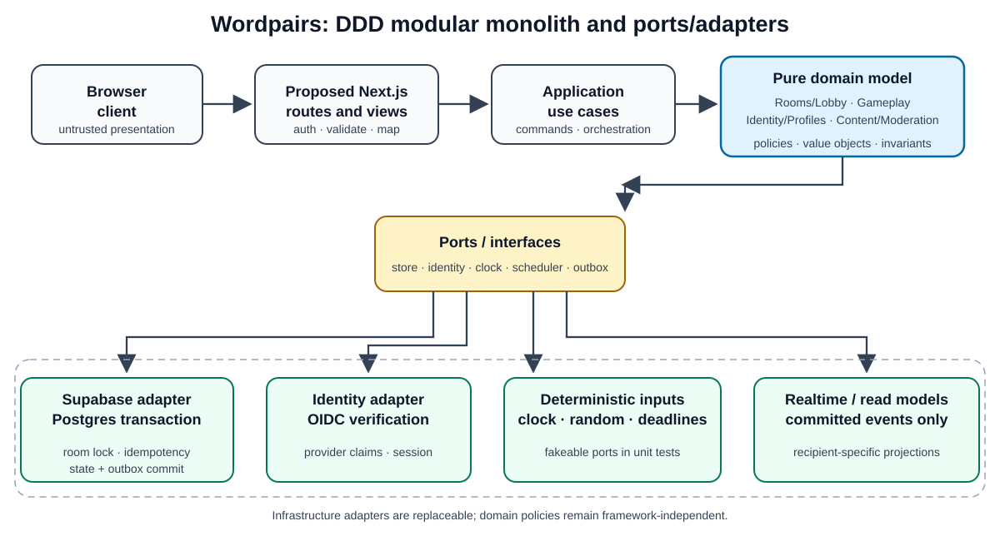

# Wordpairs Architecture Pattern Decisions

**Status:** Selected architectural direction; detailed interfaces remain subject to Phase 0 design review  
**Requirements baseline:** `word_association_game_requirements.md` v2.5  
**Related documents:** [`implementation_plan.md`](implementation_plan.md), [`deployment_plan.md`](deployment_plan.md)

## 1. Decision summary

Build Wordpairs as a **DDD modular monolith** with **ports and adapters**, **pure domain policies**, **transactional aggregate commands**, **idempotent command handling**, and a **transactional outbox** for committed state changes. Use **CQRS-lite** only for public/read-only projections such as the landing-page leaderboard and discoverable-lobby list. Keep the application in one deployment on the required Vercel target and use required Supabase Postgres as the concurrency arbiter and durable state store. Next.js/TypeScript is the proposed application stack pending a Phase 0 architecture decision record.

The design favors boundaries that can be tested with fakes and unit tests, while the database serializes contending mutations. It avoids microservices, distributed transactions, duplicated rule implementations, and full event sourcing. A room has at most 25 players, and its database record provides a natural contention boundary.

## 2. Architectural shape

Browser and proposed Next.js presentation code call application use cases. Use cases depend on domain policies and ports; production adapters implement those ports with Supabase/Postgres, the approved OIDC provider, and deployment metadata. Browser code never calls privileged adapters. Server routes/actions authenticate the caller, validate transport input, invoke a use case, and map its result. The domain imports no Next.js, Supabase SDK, React, or network clients.

### 2.1 DDD bounded contexts

| Context | Owns | Primary aggregate / policies |
|---|---|---|
| **Identity and Profiles** | OIDC verification, guest session, profile/icon, approved public label | `Profile`; identity association and guest lifecycle. |
| **Rooms and Lobby** | Room capacity, ordered players, observer invitation context, readiness, idle prompt, holdout warning, countdown, and roster lock | `Room`; membership, capacity, promotion, and readiness. |
| **Gameplay** | Match roster snapshot, anchor/category selection, round/stage state, answer acceptance, score, elapsed time, standings | `Match` and current `Round`; answer, scoring, hint-visibility, and ranking policies. |
| **Content and Moderation** | Curated categories/pairs, nominations, suggestions, moderation state, editorial completion, catalog release | `Candidate`, `ModerationCase`, immutable `CatalogItem` versions. |
| **Delivery and Operations** | Provisioning, migrations, deployment metadata, SWBOM, archives, quota status | Build/release use cases and operational adapters, not game-domain policy. |

Contexts own their language and state. Cross-context work uses application interfaces and explicit IDs/events; one context does not directly mutate another context's tables. Avoid a broad `GameService` or `Repository` that hides multiple responsibilities.

### 2.2 Aggregates and consistency boundaries

- **Room aggregate:** concurrency boundary for player seats, observers, ordered roster, readiness, countdown, and roster lock. Every membership/readiness mutation locks or version-checks the room before changing child records.
- **Match aggregate:** captures the start roster and content version, and coordinates round/stage progression, accepted submissions, scores, and result snapshots. It does not re-read a changing lobby roster after countdown lock.
- **Moderation case:** review transitions are versioned and authorized. Catalog activation is separate; a threshold or approval never automatically publishes a pair.
- **Catalog item/version:** a live match points to an immutable content version so edits or disablement cannot silently alter a round in progress.

Keep aggregates limited to the invariants that must commit together. Do not make unrelated reads or a whole match contend on a single write lock.

## 3. Application and domain patterns

### 3.1 Ports and adapters

Application use cases depend on narrow interfaces such as `RoomCommandPort`, `MatchCommandPort`, `ContentCatalog`, `IdentityVerifier`, `Clock`, `RandomSource`, `DeadlineScheduler`, `EventOutbox`, and `QuotaStatus`. Production adapters implement these interfaces; tests supply fakes. Inject time and randomness. Do not call wall-clock or global random functions from core policies.

Keep route handlers thin: transport parsing, authentication, request schema validation, use-case invocation, and response mapping. An input schema is not authorization; the server derives actor identity and permission from verified session state.

### 3.2 Pure domain policies and value objects

Represent business concepts with small value objects and named policies (examples: `RoomCapacity`, `RoomId`, `PlayerId`, `RosterPosition`, `ReadyDeadline`, `HintStage`, `Score`, `AcceptedAnswerPolicy`). Pure functions receive state plus an explicit command/context and return a decision or domain error. They perform no database, network, logging, or UI side effects.

Keep open policies explicit. Answer normalization, no-response behavior, tiebreaks, nomination counting, and leaderboard rules must not be hidden in helper defaults before the owner approves them.

### 3.3 DRY without erasing trust boundaries

- Keep each business rule in one canonical domain policy. The UI can explain or disable an action, but the server re-evaluates the rule as authority.
- Reuse request/response schemas and error definitions at transport boundaries where practical. Authorization always uses server-derived identity.
- Use database constraints for hard invariants (unique membership, capacity range, idempotency keys, foreign keys) as final backstops. They complement domain validation; they do not become divergent implementations of complex gameplay rules.
- Generate TypeScript database types from the versioned schema where the approved toolchain supports it. Keep runtime parsing at untrusted boundaries and contract-test schema drift.
- Avoid copy-pasted validation across routes, UI, RPCs, and admin pages. If a rule is intentionally repeated at a trust boundary, document the reason and test that the outcomes agree.

## 4. Concurrency and durable-event patterns

### 4.1 Transactional room command

All room mutations go through one server command handler and one database transaction/RPC. For a command that can contend on a room:

1. Accept an authenticated actor, room ID, command ID/idempotency key, expected version where appropriate, and requested intent. Never accept a client-authored authoritative roster, capacity, score, timestamp, or role.
2. Check the idempotency record. If that command ID already committed, return its prior canonical result without applying it twice.
3. Acquire the room aggregate row lock, or use version compare-and-swap where appropriate. Lock in a consistent order: room root first, then child rows in stable key order.
4. Re-read authoritative state inside the transaction; evaluate the domain decision against it; reject stale or invalid transitions without partial writes.
5. Apply membership/readiness/countdown changes and increment the aggregate version. Database uniqueness/check constraints defend against duplicate seats and invalid values.
6. Insert the idempotency result and an outbox/event record in the same transaction as the state change. Commit once.
7. Deliver only the committed, allowlisted event to the correct audience. Delivery retry uses an event ID and cannot reapply the command.

For the final room seat, the transaction is the serialization point: concurrent joins cannot both take the same open seat. The same room boundary covers pre-countdown observer promotion, roster compaction, all-ready transition, holdout expiry, countdown lock, and post-lock departures.

### 4.2 Version checks and stale timers

Use aggregate versions to reject commands based on stale snapshots. Store deadlines as server timestamps plus the aggregate version that created them. A timer callback includes its expected version; if the room changed, the callback does nothing and current state is re-evaluated. The client clock may display a countdown but cannot cause an authoritative transition.

The mechanism that wakes the server at the 30-second idle deadline and five-second holdout deadline must be verified against the approved free-tier services. Keep it behind a `DeadlineScheduler` port; do not rely on a Vercel process staying alive or on a browser timer as authority. The scheduler must be idempotent and able to discard stale-version jobs.

### 4.3 Deterministic event ordering

Use database-generated acceptance timestamps and a monotonic event/sequence key to resolve submissions accepted at the same timestamp precision. The first correct accepted event in that stable order chooses the category. Apply an approved stable ordering to observer arrival and serialized lobby transitions; where product behavior for a tie is unspecified, retain an explicit decision rather than inventing a client-side order.

### 4.4 Transactional outbox, not publish-before-commit

Write a compact outbox row with each state change inside the same transaction. Realtime delivery reads/broadcasts only committed outbox entries. Clients deduplicate by event ID and can recover missed notifications by fetching the latest authorized projection. Retain only the event history needed for retry/audit and approved retention; never store raw guesses or tokens.

This provides atomic “state changed + event exists” behavior without full event sourcing. Postgres state remains authoritative; the outbox is delivery/audit evidence. Use audience-specific event projections so observer, player, and public landing views cannot receive private fields.

## 5. CQRS-lite read models

Separate read projections where the privacy/query shape differs:

- **Public landing:** approved leaderboard fields and discoverable/joinable lobby metadata only.
- **Lobby player view:** room status/capacity/ordered players/readiness under approved visibility rules.
- **Observer view:** inviter-authorized player view, read-only, with server-side permissions.
- **Round view:** recipient-specific hints and scorecard; no target or other players' guesses before reveal.
- **Moderator view:** only data needed for an authorized decision.

Use database views/RPCs or application DTO mappers with explicit allowlists. Do not return table rows directly to the browser. Caching must respect visibility and approved staleness; never cache private room data under a public key. This is CQRS-lite: one transactional source of truth, no separate search database, and no event-sourced rebuild pipeline.

## 6. Testing architecture implied by the patterns

| Test level | Pattern proof |
|---|---|
| Pure domain unit | Run room capacity/promotion/readiness, scoring, answer, and moderation policies with plain objects, fixed clock/randomness, and no Next.js/Supabase imports. |
| Use-case/mock | Inject fakes for room/match stores, identity, clock, scheduler, and outbox. Verify port calls/error handling without simulating the production rule inside a mock. |
| Adapter contract | Run the same repository/event contracts against the Supabase adapter and test fake, including transaction result shape, idempotency, RLS authorization, and serialization. |
| Concurrency integration | Against local/disposable Supabase, launch simultaneous final-seat joins, last-ready commands, observer promotion vs countdown, and correct answers. Assert capacity/roster invariants, stable accepted order, no duplicate effects, and one outbox row per committed state version. |
| Browser acceptance | Run multi-client flows; inspect recipient-specific projections, reconnect recovery, landing privacy, and accessibility. Mock external OIDC and nonessential services; never use Production data. |
| Architecture guard | Check that `domain/` cannot import Next.js, Supabase SDKs, React, or network adapters, and that route handlers do not implement domain rules directly. |

The AC-to-test matrix remains the coverage ledger. Each increment authors tests and validates them with mocks before production code. Concurrency integration tests follow mock-first unit/use-case tests; they do not replace them.

## 7. Patterns not selected

- **Microservices:** unnecessary deployment/coordination cost for one small game and inconsistent with the free-tier constraint.
- **Full event sourcing:** adds operational and privacy/retention complexity; relational state plus transactional outbox is sufficient.
- **Full CQRS with separate stores:** adds consistency lag and infrastructure; use explicit read projections over Postgres.
- **Distributed locks or in-memory mutexes:** Vercel instances are not shared durable coordinators. Postgres transactions/version checks are the authority.
- **UI-first rules or duplicated server/RPC policy:** creates inconsistent outcomes and exploitable gaps. UI aids usability; server/domain and database invariants decide.

## 8. Adoption gates

Before implementation, approve aggregate boundaries, command contracts, outbox shape, idempotency retention, locking/version approach, RLS, and deadline scheduler. Validate local/Free-tier support for transaction and wake-up behavior. If a platform constraint prevents a selected pattern, record an ADR and preserve its observable invariants and mock seams rather than silently weakening them.

