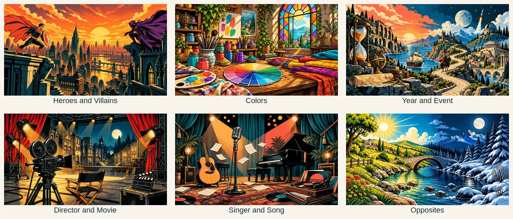
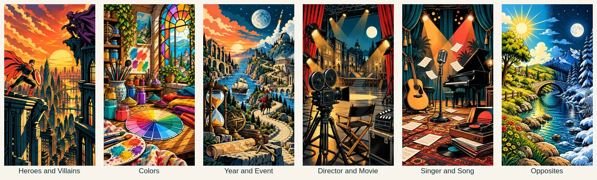

# Category artwork

The operator approved cel-shaded comic panels and a translucent content panel on 27 October 2026. This replaces the initial abstract SVG patterns with six distinct illustrated environments.

| Category | Scene | 9:16 phone | 16:9 desktop |
| --- | --- | --- | --- |
| Heroes and Villains | Original rooftop rivals above an angular sunset city | [heroes-9x16.webp](../public/backgrounds/heroes-9x16.webp) | [heroes-16x9.webp](../public/backgrounds/heroes-16x9.webp) |
| Colors | Pigments, complementary colors and an artist's studio | [colors-9x16.webp](../public/backgrounds/colors-9x16.webp) | [colors-16x9.webp](../public/backgrounds/colors-16x9.webp) |
| Year and Event | History and discovery, from stone arches to spaceflight | [years-9x16.webp](../public/backgrounds/years-9x16.webp) | [years-16x9.webp](../public/backgrounds/years-16x9.webp) |
| Director and Movie | Camera, clapperboard, curtains and a cinema soundstage | [directors-9x16.webp](../public/backgrounds/directors-9x16.webp) | [directors-16x9.webp](../public/backgrounds/directors-16x9.webp) |
| Singer and Song | Microphone, instruments, records and stage lights | [singers-9x16.webp](../public/backgrounds/singers-9x16.webp) | [singers-16x9.webp](../public/backgrounds/singers-16x9.webp) |
| Opposites | Sunny meadow and moonlit snowy woodland joined by a river | [opposites-9x16.webp](../public/backgrounds/opposites-9x16.webp) | [opposites-16x9.webp](../public/backgrounds/opposites-16x9.webp) |

The shared art direction uses ink outlines, flat colors, cel shadows and halftone accents. Assets were created with the built-in image-generation tool. Exact prompts, original-generation hashes, optimized asset hashes and byte sizes are retained in [the provenance manifest](category-artwork-prompts.json). The earlier painterly exploration and single-aspect comic concepts were superseded by the approved two-aspect comic compositions and are not shipped. Portraits and landscapes were recomposed with the image-generation tool, then resampled without content cropping to exact 864×1536 and 1536×864 delivery dimensions. No stock images, recognizable performers, franchise logos or existing comic characters were requested.

## Rendering and readability

The existing category IDs and catalog mappings remain stable. Every pair in one category shares the same pair of local WebP assets: 864×1536 (9:16) and 1536×864 (16:9). The illustration fills a fixed page background, centered and scaled to cover the viewport. It is not displayed inside a card, banner or artwork panel. Portrait viewports select the 9:16 composition; landscape viewports select 16:9. A viewport resize listener updates the selected asset when orientation changes, and is removed when the game component unmounts. Decorative art is excluded from the accessibility tree and cannot intercept pointer input.

The content surface is warm cream at 88% opacity, with 10px backdrop blur, so the illustration shows through softly. Text is never drawn directly over the unfiltered illustration. Opaque answer fields and buttons retain clear boundaries. The navigation and install-instructions areas receive the same readable translucent treatment while the game background is mounted. The translucent fill remains readable when backdrop blur is unsupported. Missing artwork falls back to the plain page color, preserves the readable content surface and leaves the existing accessible retry action available.

## Traceability and verification

QBrain is authoritative: `FR-CATEGORYART-006#ART-COMIC-01` records the six comic illustrations; `FR-CATEGORYART-006#ART-PANEL-01` records the translucent readable content panel over a page background; `FR-CATEGORYART-006#ART-ASPECT-01` records both aspect ratios and orientation switching. Existing `AC-05` and `AC-44` criteria and their historical evidence are preserved. The existing native mapping to `TEST-CATEGORYART-005` is reused. The supported technical baseline remains `TR-ART-RENDER-007#TR-07-C01`.

[Browser integration checks](../tests/browser/accessibility.phase6.spec.ts) load every category at 390×844 and 1440×960, decode the real image, check the selected background, viewport-sized fixed artwork, absence of an artwork panel, orientation switching, enabled answer input and horizontal overflow, and calculate prompt contrast over both black and white underlays. They verify game/header/install text contrast and translucency with blur enabled and disabled, plus missing-image recovery, retry, keyboard/touch answering and the 25-player phone scorecard. These checks use actual React UI and domain/application services with isolated HTTP/time/persistence fixtures; they do not certify live Realtime delivery or physical devices.

Repeat the checks with `WORDPAIRS_BROWSER_PATH=/usr/bin/chromium npx playwright test --config playwright.phase6.config.ts tests/browser/accessibility.phase6.spec.ts` in a POSIX shell, or set that environment variable using the current shell's syntax. The normal configuration uses the local development server; the implementation receipt uses a task-isolated production server. [Evidence and source hashes](evidence/category-artwork/receipt.json) bind the results to the inspected files. Criterion satisfaction is recorded only after bounded execution evidence is captured and read back from QBrain.
