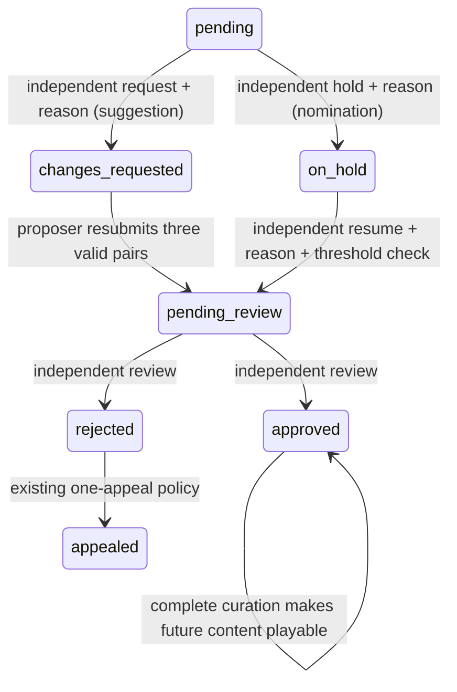

# UI gap implementation and verification

This implementation realizes [UI-DEC-01..08](decisions.md) and the linked QBrain records. The implementation snapshot is identified by the SHA256 manifest in `implementation-manifest.json`; the Git base remains3273c121de6517aec34503d8c769b0159e9e52df with preserved pre-existing local work. The final [execution receipt](implementation-receipt.json) distinguishes source, browser/port fixtures, real SQL and remaining operational dependencies.

Moderators can request changes to a suggestion, hold a nominated candidate and resume its review with a reason. Proposers alone can revise a changes-requested category and its three pairs. Both legacy `pending` and new `pending_review` records support ordinary independent review. Deferrals never publish, consume an appeal or change scores. Atomic content audits retain actor, reason, case version, prior/new status and prior/new proposal. Migration011 extends the status constraint and one-open unique index without rewriting historical evidence.

Drafts and uncertain commands live only in tab memory. Internal Next links preserve them across ordinary navigation. A purpose-separated opaque session-generation value accompanies verified session reads/guest entry; a replacement session for the same profile also clears old drafts, commands and component state. This value is neither the raw cookie nor its credential-store hash and cannot authenticate a request. Cancel/Escape in the native profile dialog makes no write and restores its opener; controls inside the dialog are draft-only until Save. Sign-out, reload, identity change and authorization loss clear private state.

A shared lock prevents duplicate submissions. Uncertain retries retain the exact endpoint, method, serialized payload and command ID across route changes. Successful results stay scoped and locked until a current mounted consumer acknowledges them, so a completed private-room creation cannot lose its destination while its original page is unmounted. Content/admin/game/room/social denial invalidates older read generations; late bodies cannot restore private projections or another session's success. No raw server/network exception is rendered. Room GET reads drain the body and handle status/ownership before parsing successful JSON; room commands use controlled failure text. Malformed GET/POST sentinel regressions verify the room alert cannot display parser body content.

No-solver summaries now schedule automatic continuation three seconds after the authoritative end. Three seconds is an automatic-advance delay, not a guaranteed minimum summary display; an optional manual Continue may advance sooner. A delayed worker starts a full20-second initial answer stage at its current time. Duplicate/manual races create one next round, and the eighth round schedules no ninth. A catalog revision race returns retryable unavailability for system deadlines so a valid job is not acknowledged as obsolete. The automatic transition is audited as `system:deadline`.

Discovery links carry UX-only provenance. A current authoritative last-seat loss returns a non-member to a fresh first-page board (`fresh=1`), with visible unavailable/retry feedback if that read fails. Existing members and uncertain winning joins are preserved; the pending command is resolved canonically. Direct room/code/invitation links retain read-only observation. Navigation alone sends no readiness or Leave command.

Styles enforce wrapping, minimum inline sizing, visible focus, contrasting control borders and44x44primary actions. Browser measurements cover320x568,390x844,844x390, the320CSS-pixel/4x-device-scale equivalent of1280at400%zoom, and200%root-text enlargement. Score/stage live-region text and error alerts are exercised with focus unchanged. These are DOM/layout and headless Chromium assertions, not physical screen-reader, Safari/iPhone or OS-installation certification.

## Repeatable checks and evidence boundaries

- `npm test -- --maxWorkers=2 --testTimeout=60000 --hookTimeout=60000`: unit/domain/application/contract tests, including command timing, independent roles, exact retries and session/result lifecycle.
- `pwsh -NoProfile -File tests/integration/run-phase1.ps1`: owned disposable PostgreSQL, all migrations, real locking/projections/atomic audit/idempotency, role denial, catalog race and the2..25service matrix. Nomination-count setup and the race-test queue selector are disclosed fixtures; their SQL command transactions are real.
- `WORDPAIRS_BROWSER_PATH=/usr/bin/chromium npm exec playwright -- test --config playwright.phase6.config.ts`: actual React pages and browser interaction. HTTP and persistence/time ports are isolated fixtures using real application/domain services. This suite proves UI behavior, not real Realtime delivery.
- `npm run typecheck`, `npm run lint`, `npm run build`: required compile/lint/production checks. The build runs after the browser server releases `.next`.

See [implementation-receipt.json](implementation-receipt.json), [evidence](../../evidence/ui-gaps/), the updated case execution sections, criterion audit and QBrain readback. The separate full private-push2..25UI run, real provider credentials and physical phone installation remain open execution dependencies; these tests do not close TEST-ROOMSYNC-139 or LIVE-07. No shared/live requirements are invented from fixtures, and no deployment, commit or push is implied.

Independent hostile validation approved the final234-file source inventory at99%accuracy/99%completeness. All seven findings and earlier rejected candidates remain in [the append-only review archive](../../evidence/ui-gaps/hostile-validation.jsonl). Final evidence is542unit/61browser/68SQL tests, plus successful lint, typecheck and production build. The reviewer independently reran9focused domain/timing/private-state tests. Approval is scoped to this UI extension and does not certify contest entry or outstanding real transport/device/provider obligations.
