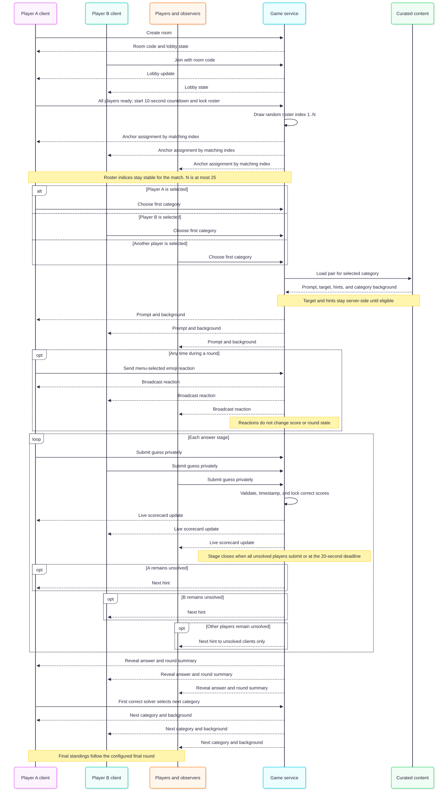

# Word Association Game Requirements

**Functional behavior, technical requirements, and acceptance criteria**  
Version 2.2 · 25 October 2026 · Draft for product approval

## Purpose and scope

This document defines a real-time word-pair game for 2–25 players who join one room from their own devices. Each curated prompt belongs to a relationship category with a predefined background. Players submit guesses through a sequence of hint stages, with more points awarded for solving earlier. Players who solve before any hint can nominate candidate answers for future curated content.

The requirements record confirmed gameplay and identify proposed defaults or unresolved choices. The deployment provider and persistence/realtime services are specified by TR-20–TR-24 (Vercel and Supabase). The application framework and programming language remain architecture choices: the current plans propose Next.js/TypeScript, subject to an explicit architecture decision before implementation. The requirements do not prescribe a networking library.

## Game landing page

The game provides a landing page that introduces Wordpairs, displays a leaderboard, shows public lobby information, and explains the gameplay rules. Visitors can view this information before authenticating or joining a room. Public lobby details must follow the approved discoverability and privacy policy; the page does not expose private room state, non-public profile data, or private player-specific game data. The leaderboard metric, time window, player labels, guest inclusion, and tie behavior remain decisions to approve before its data contract is implemented.

## Status labels

- **Confirmed** means the rule was specified by the player.
- **Proposed** means a default was suggested but not approved.
- **Open** means the behavior still needs a decision.

## Game terms

| Term | Definition |
|---|---|
| Prompt word | The visible word shown at the start of a round. Players enter its predefined paired answer. |
| Word pair | The prompt and target answer stored under a relationship category. |
| Anchor player | The player selected by the game to choose the opening round’s category. |
| Hint stage | One answer opportunity with a fixed hint level. The first stage has no hint, followed by Hint 1, Hint 2, and Hint 3. |
| Solved player | A player whose submission matches the curated target or an approved accepted answer. |
| Elapsed answer time | Time from the start of a round until the player submits a correct answer. |
| First correct solver | The player whose correct submission the game service accepts first in a round. |

## Confirmed game rules

Players join by room code and play from their own devices. Each room supports 2–25 players. A player chooses an icon in their profile. That icon appears in the room, live round scorecard, round summary, and final standings.

At the start of the game, the game numbers the active roster from 1 through the number of players, using the roster order captured when the game starts. It draws a random integer from 1 through the player count; the player whose index matches that number becomes the anchor player and chooses the first round’s category. The roster index remains stable for the match. After each round, the first player to answer correctly chooses the next category. The category determines the background artwork for every word pair in that category.

A round starts with the prompt word and no hint. Every unsolved player submits a word. Once all unsolved players have submitted, the game reveals who solved the prompt. Players who remain unsolved receive Hint 1 and another answer opportunity. The same sequence continues through Hints 2 and 3. A player who remains unsolved after Hint 3 earns zero points and the round ends.

The scorecard on the active round page fills in as players solve. Each solved row shows the player, their points for that round, and how long they took to solve it. A separate summary screen ranks every player by current cumulative score after each round.

If a player leaves a full room before the game starts, the oldest observer is promoted to the final player position. The remaining players move up to close the vacancy, preserving their relative order. If no observers are waiting, the room simply has an open player slot.

At the end of the game, if players tie for the highest score, the player who used the least total time to answer the words wins. The exact treatment of unsolved words and a tie on total time remains open.

### Scoring

| Solve stage | Points |
|---|---:|
| Correct before any hint | 5 |
| Correct after Hint 1 | 3 |
| Correct after Hint 2 | 2 |
| Correct after Hint 3 | 1 |
| Still unsolved after Hint 3 | 0 |

### Initial relationship categories

- Heroes and Villains
- Colors
- Year and Event
- Director and Movie
- Singer and Song
- Opposites

The category examples define pair relationships, not individual word-specific art. Every pair in one category shares that category’s predefined background. The exact pair set for each category is content data.

### Future answer nominations

A player who solves a round during the no-hint stage may nominate a word as a candidate answer for future games. A candidate enters the future-eligible answer pool only after it receives at least 10 nominations and passes moderation. It must still be incorporated into a complete curated word-pair record, including its prompt, category, three hints, accepted answers, and category background, before it can be played. Nominations do not change the current round or its score.

## Room creation and join flow

Any player already in a room can invite others by sharing the room code or its deep link. A deep link opens the room directly and bypasses lobby browsing. Every player join checks the configured capacity. If the room is full, an invited player can choose read-only observer mode and follow the inviter’s player-specific view in real time; observing does not consume a player slot. Before the game start countdown begins, if a player leaves while the room is full, the oldest observer is promoted into the final player position and the remaining players move up to close the vacancy. If the lobby state remains unchanged for 30 seconds before the start countdown, all players are prompted to mark themselves ready. When all but one player have marked ready, the remaining player receives a five-second warning to mark ready. If the warning expires while they remain unready, that player is removed from the room and the start countdown begins. When every player has marked ready, the countdown begins immediately. In either case, the roster locks when the countdown begins, and a player who leaves afterward is not replaced.

## Lobby discovery flow

Proposed behavior: only rooms marked discoverable appear in browsing or quick match. Room-code joining remains available. Quick match chooses a discoverable lobby that has room for another player; if none is available, the player can keep browsing or create a room.

## Identity and profile entry flow

Both entry modes provide a player identity and selectable icon for the current game. Guest profile persistence across games or devices remains an open decision.

## Round flow

The live scorecard may show solved status as soon as a correct answer is accepted. Submitted guess text remains private during the round. At each stage close, all players can see who solved before the next hint appears for the remaining unsolved players.

## Client and message flow

The game service owns the room state and validates answers. It sends prompt and category background to every player, sends later hints only to unsolved players, and broadcasts scorecard and standings updates without exposing submitted guess text. During a round, players can send a menu-selected emoji reaction that the service broadcasts in real time to players and observers in the room.

## Category and pair suggestion flow

The three submitted pairs are suggestions and do not become playable automatically. Each pair must meet the existing content requirements, including prompt, target answer, hints, accepted answers, and category background.

## Nomination flow

The nomination and moderation path is separate from live round progression. A candidate must satisfy both the nomination threshold and moderation approval; neither condition alone is sufficient.

## Deployment workflow

Provisioning is run manually from a developer workstation with authenticated Supabase and Vercel CLIs. The script creates or links the Supabase and Vercel projects, applies versioned database migrations, and configures environment variables without committing credentials. A one-time Git integration connects `sharpninja/wordpairs` to Vercel. Subsequent branch pushes create preview deployments; merges to `main` create production deployments. GitHub Actions is not used or required.

## Functional requirements

### Player access and identity

**FR-01 Room access — Confirmed.** Players can create a room and set its maximum player capacity from 2 through 25, inclusive. Players can join from their own device by room code, discoverable-lobby browsing, quick match, or a deep link containing the room code. Joining as a player requires an available slot under the room’s configured capacity. If the room is full, an invited player can choose observer mode.

**FR-02 Player profile — Confirmed.** Each player can select an icon in their game profile before or while joining a room. The selected icon appears consistently in the room, live scorecard, round summary, and final standings. A display-name field is a proposed companion feature; see the decision register. Players may establish a profile by authenticating with OpenAI OIDC or enter as a guest.

**FR-03 Lobby — Partly open.** The room view displays the room code, configured maximum capacity, available player slots, current players, and observers separately. A game cannot start with fewer than 2 players. Any player in the room can invite others by sharing its code or deep link. The room identifies the anchor player. Before the game start countdown begins, when a player leaves a full room, the oldest observer is promoted into the final player position and the remaining players move up to close the vacancy. If the lobby state remains unchanged for 30 seconds before the start countdown, all players are prompted to mark themselves ready. When all but one player have marked ready, the holdout receives a five-second warning to mark ready. If it expires while they remain unready, they are removed from the room and the countdown begins. If all players mark ready first, the countdown begins immediately. The roster locks when the countdown begins; a player who leaves afterward is not replaced. Host and start-control behavior needs confirmation. Players can also discover and join open lobbies using browsing or quick match; discoverability rules and matching details are proposed and listed in the decision register.

### Curated content and categories

**FR-04 Predefined content — Confirmed.** Every playable word pair has a predefined category, prompt word, target answer, and three ordered hints. The game uses this content at runtime and does not generate prompts or hints dynamically.

**FR-05 Relationship categories — Confirmed.** The initial category set supports Heroes and Villains, Colors, Year and Event, Director and Movie, Singer and Song, and Opposites. Each pair belongs to one category.

**FR-06 Category backgrounds — Confirmed.** Each category maps to one predefined background asset. All word pairs in the same category use that background. The background must remain legible behind the prompt, hints, answer field, and scorecard.

### Round play and scoring

**FR-07 Category selection — Confirmed.** At game start, the service snapshots the active roster in roster order and indexes players from 1 through N. It draws a random integer from 1 through N, inclusive; the player with the matching index becomes the anchor and chooses the first round’s category. The index remains stable for the match. After each round, the first correct solver chooses the next category. The game uses the earliest accepted correct submission to identify that player.

**FR-08 Answer stages — Confirmed.** The first answer stage has no hint. Each unsolved player gets one submission per stage. Once all unsolved players submit, the game confirms stage results and reveals the next predefined hint only to those who remain unsolved. This repeats for up to three hints.

**FR-09 Scoring — Confirmed.** The game awards 5 points for a correct answer before hints, 3 after Hint 1, 2 after Hint 2, and 1 after Hint 3. A player who remains unsolved after Hint 3 earns 0 points.

**FR-10 Score lock and elapsed time — Confirmed.** When a player submits a correct answer, the game locks that player’s score for the round and records elapsed time from round start to the accepted correct submission.

**FR-11 Live round scorecard — Confirmed.** The active round page shows every player and updates a player’s row when they solve. A solved row shows the player icon, points earned in the current round, and elapsed answer time. Incorrect guess text is not exposed to other players.

**FR-12 Round reveal — Confirmed.** When a round ends, the game reveals the correct paired answer. Players who remain unsolved after Hint 3 receive zero points for that round.

**FR-13 Round summary — Confirmed.** After every round, the game displays a ranking of all players by cumulative score. It also shows the points and elapsed time earned in the completed round.

**FR-14 Game end and tiebreak — Partly open.** When the configured match length is complete, the game displays final standings. If the highest score is tied, the player with the lowest total answer time ranks first. Match length, time aggregation, and a tie remaining after the time comparison need approval.

**FR-16 Future answer nominations — Confirmed.** A player who correctly solves during the no-hint stage may nominate a word as a candidate answer for future games. The game records nominations by candidate word. A candidate becomes eligible for the future answer pool only after it has at least 10 nominations and passes moderation. Before it is playable, content editors must create a complete curated pair record with the required prompt, category, hints, accepted answers, and category background. Nominations do not affect current-round scoring or progression.

**FR-17 Category and pair suggestions — Confirmed.** After a player has won 10 games, the player can suggest a new relationship category and submit three word pairs for that category. Suggestions enter review and moderation; approval does not bypass the existing curated-content requirements. Approved pairs become eligible for future games only after their complete content records and category background are ready.

**FR-18 Identity modes — Confirmed.** Before creating or joining a room, a player can authenticate with OpenAI OIDC to establish or load a game profile, or continue as a guest. Both modes provide the player identity needed for room membership and allow icon selection. Guest persistence across games or devices is unresolved.

**FR-19 Lobby discovery and matching — Partly confirmed.** Players can browse discoverable open lobbies or use quick match to join an available lobby for this game. Any player in a room can share its room code or deep link to invite others; a deep link bypasses lobby browsing. Joining as a player requires an available slot under the configured capacity. An invited player who reaches a full room can choose observer mode. Before the game start countdown begins, if a player leaves a full room, the oldest observer is promoted into the final player position and the remaining players move up to close the vacancy. If the lobby remains unchanged for 30 seconds before the countdown, all players are prompted to mark ready. When all but one player have marked ready, the holdout receives a five-second warning. If it expires while they remain unready, they are removed from the room and the countdown begins; if they mark ready before it expires, the countdown begins immediately. The roster locks when the countdown begins, and a player who leaves afterward is not replaced. Whether rooms are discoverable by default and the quick-match selection policy remain proposed.

**FR-20 Full-room observer mode — Confirmed.** If an invited player attempts to join a room with no open player slot, the invitee may choose to observe the game in real time from the perspective of the player who invited them. Observer mode does not take a player slot, submit answers, make category choices, or earn points. The observer sees only the game information available to the followed player. Before the game start countdown begins, if a player leaves a full room, the observer who entered earliest is promoted to the final player position; the other players move up to close the vacancy. Remaining observers keep their observer status. When all but one player have marked ready, the holdout receives a five-second warning to mark ready. If the warning expires while they remain unready, they are removed from the room and the countdown begins; if all players mark ready first, the countdown begins immediately. The roster locks when the countdown begins. If a player leaves after countdown begins, no observer or other player replaces them.

**FR-21 Emoji reactions — Confirmed.** During any active round, a player can open an emoji menu and display a selected emoji reaction to the room in real time. Reactions do not submit an answer, change round state, or affect scoring. Observers see reactions displayed by the player they are following and reactions broadcast to the room.

**FR-22 Public landing page — Confirmed.** An unauthenticated visitor can open the game landing page and view an approved leaderboard, public lobby information, and the gameplay rules. Lobby information is limited to approved public metadata for discoverable, joinable rooms and cannot expose private room codes, hidden answers, guesses, observer-only views, or credentials. The exact leaderboard metric, time window, tie order, display labels, and guest inclusion, plus the public lobby fields and refresh behavior, must be approved before implementation.

### Presentation

**FR-15 Responsive screens — Confirmed.** Profile, lobby, active round, hint stage, scorecard, round summary, category picker, and final standings remain usable on phone-sized screens in portrait and landscape orientation.

## Direct dependency set

The game is licensed under GNU GPL version 2 only (`GPL-2.0-only`), with the complete license text in the repository root `LICENSE` file. The planned runtime dependencies are Next.js, React, React DOM, `@supabase/supabase-js`, `@supabase/ssr`, `openid-client`, and Zod. Next.js provides the Vercel application framework; Supabase packages provide database and Realtime access plus server-rendered session handling; `openid-client` implements the OpenID Connect flow; Zod validates untrusted input at application boundaries.

The planned development and test dependencies are TypeScript and its Node/React type packages, Vitest, React Testing Library, `@testing-library/user-event`, `@testing-library/jest-dom`, jsdom, Mock Service Worker (MSW), Playwright, and `@cyclonedx/cyclonedx-npm` for build-specific software bills of materials. Vitest, Testing Library, and MSW support the required mock-first unit and component tests; Playwright covers browser-level acceptance flows with network calls intercepted or mocked where applicable. Every acceptance criterion must map to tests before production code is written. The test command must pass before the Vercel build command proceeds.

Exact compatible versions are selected and locked when implementation begins. Maintain package purposes, license identifiers, and upstream links in [`ATTRIBUTIONS.md`](ATTRIBUTIONS.md); refresh it whenever a direct dependency or external asset changes. Before distributing code or assets as part of the game, verify their licenses are compatible with `GPL-2.0-only` and preserve their notices. Build and test tools are not bundled into the game. Follow the per-deployment artifact contract in [`SWBOM.md`](SWBOM.md).

## Technical requirements

**TR-01 Authoritative room state.** A server-side game service owns room membership, round state, accepted answers, hint stage, scoring, solve timestamps, category choice, and match completion. Clients cannot award points or change a target answer.

**TR-02 Real-time synchronization.** The service synchronizes room membership and round updates to all connected players. A confirmed correct answer updates the live scorecard, and all clients progress through the same hint stage.

**TR-03 Submission ordering.** The service records an authoritative acceptance time for each submission. The first correct accepted answer determines the next-category chooser. If submissions arrive at effectively the same time, the service applies a deterministic ordering rule.

**TR-04 Answer validation.** The service validates each submission against the pair’s target and its approved accepted-answer list. Capitalization, whitespace, punctuation, and synonym handling follow an approved answer-matching policy.

**TR-05 Answer confidentiality.** The target answer remains unavailable to clients until round reveal. A hint is sent only to clients that remain unsolved. Solved players receive no later hints or answer controls for that round.

**TR-06 Curated content integrity.** Every playable pair has a category identifier, prompt, target answer, three ordered hints, accepted answers, and a category-background reference. A category cannot be enabled unless its required content and background are present.

**TR-07 Background rendering.** Category backgrounds load on supported phone screens. An overlay or equivalent treatment preserves text contrast. A missing asset must not make round controls unreadable.

**TR-08 Clock consistency.** Elapsed answer time uses a consistent server-controlled round start time and accepted submission time. Client clocks may animate locally, but scorecard and tiebreak values use authoritative times.

**TR-09 Connection handling.** A brief disconnect must not corrupt accepted scores or duplicate a submission. Reconnection and timeout behavior must be defined before release.

**TR-10 Room code handling.** Room codes identify the intended active room and reject invalid or expired codes. Each room stores a configured capacity from 2 through 25. Room-code joins and deep-link joins use the same authoritative slot check as lobby browsing and quick match. When full, a valid invite permits the player to request observer mode instead of a player slot. Code length, expiration, and rate limiting remain implementation decisions.

**TR-11 Mobile input.** Primary actions work with touch and keyboard input. Category art does not obstruct text entry, hints, score status, or buttons in either phone orientation.

**TR-12 Accessibility and readability.** Text and controls maintain clear contrast over every category background. Focus, selected icons, solved status, and score changes use labels or shapes as well as color.

**TR-13 Anchor assignment.** At game start, the service snapshots and indexes the active roster from 1 through N, where N is 2–25. It draws a random integer uniformly from 1 through N, inclusive, and assigns the matching player as anchor for the match. The index remains stable for the match. The service accepts the first category selection only from the anchor and synchronizes the assignment and selected category to all room clients.

**TR-17 Lobby discovery and matching.** The service lists only discoverable lobbies with available player slots under their configured capacity. Quick-match and all player-seat assignments are atomic: concurrent requests cannot exceed room capacity. Deep links containing a valid room code route directly to that room without lobby browsing, then use the same authoritative open-slot check. A valid invite to a full room may establish an observer session without reserving a player slot. Lobby discovery responses expose only approved lobby metadata, not private room state.

**TR-19 Emoji reaction delivery.** The service accepts only emoji selections provided by the game’s menu, associates each reaction with its player, and broadcasts it to connected players and observers in the room in real time. Reactions are informational events and cannot mutate scores, answer submissions, hint state, category selection, or match state.

**TR-18 Observer perspective and permissions.** An observer session is read-only and is bound to the player who invited the observer. The service streams the same player-authorized game view that the inviter’s client receives, including updates as the inviter’s view changes, while rejecting guesses, category choices, and other game-affecting commands from the observer. Observers do not count toward player capacity or scoring.

**TR-16 Identity and authentication.** The service supports OpenAI as an OIDC identity provider for account-backed game profiles and supports guest identities without OIDC authentication. OIDC tokens must be validated by the service before associating a profile with the authenticated subject. The service must not treat client-supplied identity claims as authenticated. Guest identity and profile persistence are governed by the approved guest lifecycle policy.

**TR-15 Category suggestion eligibility and review.** The service tracks game wins for each player and unlocks category-and-pair suggestions when the player reaches 10 wins. It stores the proposed category and its three proposed word pairs as one submission, tracks its review status, and prevents unapproved or incomplete content from entering the playable catalog. The scope and persistence of win counts must follow an approved policy.

**TR-14 Candidate nomination and moderation.** The service permits nomination submission only for a player who solved the current round before any hint. It stores each nomination against a normalized candidate word and records its nominating player and timestamp. Candidate eligibility requires both at least 10 nominations and an approved moderation status. Moderation status, nomination count, and eligibility state must be auditable. An eligible candidate cannot be played until a complete curated word-pair record exists.

**TR-20 Vercel deployment target.** Deploy the web application from the `sharpninja/wordpairs` GitHub repository to Vercel. Use Vercel’s Git integration: pushes to non-production branches create Preview deployments, and changes merged to `main` create Production deployments. Select the framework preset, project root, build command, and output directory to match the implementation once its framework is approved.

**TR-21 Free-tier operation.** The deployment must remain on free tiers: Vercel Hobby and Supabase Free. Do not enable paid add-ons, metered upgrades, or paid external services. The product is personal and non-commercial while using Vercel Hobby. Current Supabase Free constraints include a 500 MB database, 200 concurrent Realtime connections, 100 Realtime messages per second, 2 million Realtime messages per month, and automatic pause after one week of inactivity. Treat these as capacity limits and provide graceful handling when service quotas are reached.

**TR-22 Persistence and real-time room state.** Use Supabase Postgres as the durable source of truth for profiles, curated pairs, nominations, moderation records, completed matches, and scores. Use Supabase Realtime for active-room presence and event delivery within its free-tier limits. Do not rely on a Vercel Function’s process memory as shared or durable room state. Keep category background assets in the repository unless a future requirement needs uploaded files.

**TR-23 Provisioning and schema changes.** Provide a manually invoked, repeatable provisioning script using the Supabase and Vercel CLIs. It must create or link the projects, apply version-controlled database migrations, and set required Vercel environment variables for Preview and Production. The script must accept authenticated credentials from the operator’s environment, never commit or print secret values, and avoid configuring paid resources.

**TR-24 GitHub Actions availability.** Build and deployment automation must not depend on GitHub Actions. Use Vercel’s Git integration for automatic branch Preview and `main` Production deployments. Run infrastructure provisioning scripts manually from an authenticated developer workstation.

**TR-25 Direct dependencies and attribution.** Declare the approved runtime and test packages as direct dependencies in `package.json`; pin compatible resolved versions through the package manager lockfile. Maintain `docs/ATTRIBUTIONS.md` with each direct package’s purpose, license, and upstream source, plus attribution for any externally sourced visual, audio, or content assets. Update it when dependencies or assets change.

**TR-26 Mock-first test gate.** Before writing implementation code for an increment, define tests for every applicable acceptance criterion, validate the tests against mocks, and then implement the smallest behavior that makes them pass. The Vercel build must run the test suite before the production build. No GitHub Actions workflow is assumed or required.

**TR-27 Per-build software bill of materials.** Generate one CycloneDX JSON 1.6 software bill of materials (SWBOM) from the exact npm lockfile for every Vercel Preview or Production deployment. Include direct and transitive runtime and development components, declared licenses, package URLs, dependency relationships, build timestamp, Git commit SHA, deployment environment, and Vercel deployment URL. Generate it after the mock-first test gate and before the application build, then bundle it into that same immutable deployment at `public/sbom/<git-commit-sha>.cdx.json`. Never include secrets or environment-variable values. Document the artifact contract in `docs/SWBOM.md`.

**TR-28 SWBOM in release archive.** Every release must include a downloadable archive containing the release contents and the SWBOM generated for the exact release commit and published build. Place the report at `sbom/<git-commit-sha>.cdx.json` inside the archive. The release packaging step must verify that the SWBOM exists and that its commit SHA matches the release before publication. Do not depend on GitHub Actions for packaging or publication.

**TR-29 Project license.** License Wordpairs source and the game under GNU GPL version 2 only (`GPL-2.0-only`). Include the complete license text in the root `LICENSE` file and include that file in each source release archive. Preserve independent third-party license notices and check compatibility before redistributing any third-party code or asset as part of the game.

**TR-30 Public landing data boundary.** Serve the landing page and its gameplay rules without requiring authentication. Retrieve leaderboard and lobby display data through a read-only, server-controlled public projection that returns only approved fields. Restrict lobby results to discoverable, joinable rooms; exclude room codes, non-public profile fields and identifiers, observer perspective data, guesses, targets, moderation records, and secrets. Use bounded pagination, a documented refresh/cache policy, and recoverable empty/unavailable states. Do not expose service-role credentials or allow the public query to mutate game state.

**TR-31 Testable domain and concurrency boundaries.** Organize application behavior as a modular monolith with explicit domain boundaries and application use cases. Keep game policies independent of Next.js and Supabase frameworks; route persistence, identity, time, randomness, and realtime effects through injected ports/adapters. Keep each business rule in one canonical domain policy, with database constraints as invariant backstops rather than competing rule implementations. Serialize conflicting room mutations in a single database transaction, enforce idempotency for retried commands, and persist the event/outbox record in the same transaction before realtime delivery.

## Acceptance criteria

Criteria that depend on an unresolved decision are provisional until that decision is approved.

| ID | Given, when, then |
|---|---|
| AC-01 Room joining | Given a valid room code and 2–25 players on separate devices, when each joins, then every joined player appears in the same room with their selected icon. |
| AC-02 Player limit | Given a room has reached its configured player capacity from 2 through 25, when another player attempts to join, then the game rejects the additional player without changing existing room state. This is true for any configured capacity, including 2, 8, and 25. |
| AC-03 Profile icon | Given a player selects an icon, when that player enters the lobby and plays a round, then the same icon appears in the lobby, live scorecard, and standings. |
| AC-04 First category | Given a new game with 2–25 players, when the game indexes the start roster from 1 through N and draws a random integer from 1 through N inclusive, then the player with that index becomes anchor; when that player chooses a category, the first round uses the chosen category and its background. |
| AC-05 Category art | Given two word pairs in the same category, when each is played, then both rounds use that category’s predefined background. A pair in another category uses that category’s background. |
| AC-06 No-hint solve | Given a player submits the correct answer during the no-hint stage, when the game accepts it, then the player earns 5 points and their round score locks. |
| AC-07 Hint scoring | Given a player solves after Hint 1, Hint 2, or Hint 3, when the game accepts the answer, then the player earns 3, 2, or 1 point respectively. |
| AC-08 Unsolved result | Given a player remains unsolved after Hint 3, when the round ends, then the player earns 0 points and the game reveals the correct answer. |
| AC-09 Hint progression | Given multiple unsolved players, when all unsolved players submit for the current stage, then the game confirms stage results and shows the next hint only to players still unsolved. |
| AC-10 Live scorecard | Given a player solves, when the game accepts the answer, then the active scorecard shows that player’s icon, points earned, and elapsed time from round start. |
| AC-11 Category choice | Given at least one player solves a round, when the round ends, then the earliest accepted correct solver can select the next category. |
| AC-12 Round summary | Given a round ends, when the summary appears, then it ranks all players by current cumulative score and shows the completed round’s points and solve times. |
| AC-13 Final standings | Given the configured final round ends, when players have different total scores, then final standings rank them by total score. |
| AC-14 Time tiebreak | Given two or more players tie for the highest score, when final standings are calculated, then the player with the lowest approved total answer time ranks first. |
| AC-15 Orientation | Given a phone-sized viewport in portrait or landscape, when a player enters an answer or views a hint and scorecard, then text and controls remain visible without horizontal overflow. |
| AC-16 Content validation | Given a category is enabled, when the content catalog is checked, then every playable pair has a prompt, target answer, three ordered hints, accepted-answer policy, and category background. |
| AC-17 Nomination eligibility | Given a player solves during the no-hint stage, when the round results are shown, then that player can submit a candidate answer nomination; players who solve after any hint cannot nominate from that round. |
| AC-18 Nomination threshold and moderation | Given a candidate has fewer than 10 nominations or has not passed moderation, when the answer pool is checked, then it is not eligible for future games. Given it has at least 10 nominations and passes moderation, then it enters the future-eligible answer pool but is not playable until its full curated pair record exists. |
| AC-19 Category suggestion unlock | Given a player has fewer than 10 game wins, when they open the content suggestion flow, then category-and-pair submission is unavailable. Given they have won 10 games, then they can submit one proposed relationship category with three word pairs for review. The submission is not playable until approved and complete. |
| AC-20 OpenAI OIDC profile | Given a player chooses account sign-in, when OpenAI OIDC authentication succeeds, then the game establishes or loads the game profile associated with that authenticated identity and allows the player to select an icon. |
| AC-21 Guest play | Given a player chooses guest mode, when they continue without OIDC authentication, then the game creates a guest player identity, allows icon selection, and lets them create or join a room by code. |
| AC-22 Browse open lobbies | Given a discoverable lobby is waiting and has fewer players than its configured capacity, when a player browses lobbies, then the lobby appears as joinable; hidden, full, or started lobbies do not appear as joinable. |
| AC-23 Quick match | Given at least one discoverable lobby has an available player slot, when a player uses quick match, then the service assigns them to one available lobby without exceeding its configured capacity. Given none is available, then the player is offered browsing or room creation. |
| AC-24 Configured capacity | Given a player creates a room, when they set a maximum capacity from 2 through 25, then the room stores and displays that limit. Values below 2 or above 25 are rejected. |
| AC-25 Room invitations | Given a player is in a room, when they share its room code or deep link, then another player can use either invitation to reach the intended room, subject to an open slot. |
| AC-26 Deep-link join and full room | Given a valid room deep link, when a player opens it, then the game bypasses lobby browsing and checks the room directly. If a slot is open, the player joins; if the room has no open player slot, the invitee is offered observer mode. |
| AC-27 Full-room observer | Given an invited player follows an invitation to a full room, when they choose to observe, then they enter without consuming a player slot and are bound to the player who invited them. |
| AC-28 Observer perspective and permissions | Given an observer is following an inviter, when the inviter’s player-authorized view changes, then the observer sees the corresponding update in real time. Observer attempts to submit guesses, choose categories, or change game state are rejected; the observer earns no score. |
| AC-29 In-round emoji reaction | Given a round is active, when a player selects an emoji from the menu, then the reaction appears in real time to room players and observers and does not change scores, answer stage, or round state. |
| AC-30 Pre-countdown observer promotion | Given a room is full and the start countdown has not begun, when a player leaves and at least one observer is waiting, then the observer who entered observer mode earliest becomes the final player in the roster, existing players move up to close the vacancy while preserving their relative order, and any remaining observers stay observers. |
| AC-31 Ready countdown and roster lock | Given every player in the room has marked ready, when the final ready state is received, then the game start countdown begins immediately and the player roster locks. If a player leaves after the countdown begins, then no observer or other player is promoted or substituted into that player’s place. |
| AC-32 Holdout warning and removal | Given all but one player have marked ready, when the room enters the holdout state, then the unready player sees a five-second warning to mark ready. If they mark ready before it expires, the start countdown begins immediately. If the warning expires while they remain unready, they are removed from the room and the start countdown begins with the remaining roster locked. |
| AC-33 Idle lobby readiness prompt | Given the game start countdown has not begun, when the lobby state remains unchanged for 30 seconds, then the game prompts all players in the lobby to mark themselves ready. |
| AC-34 Vercel branch deployments | Given the Vercel Git integration is connected to `sharpninja/wordpairs`, when a non-production branch is pushed, then Vercel creates a Preview deployment; when a change is merged to `main`, then Vercel creates a Production deployment. No GitHub Actions workflow is required. |
| AC-35 Free-tier deployment | Given the project is provisioned, when deployment and storage resources are inspected, then Vercel Hobby and Supabase Free are used, no paid add-on or metered upgrade is enabled, and the project is configured for personal non-commercial use. |
| AC-36 Repeatable provisioning | Given valid authenticated Supabase and Vercel CLI sessions, when the provisioning script is run, then it creates or links the required projects, applies version-controlled database migrations, and configures Preview and Production environment variables without placing secret values in repository files or logs. |
| AC-37 Free-tier quota handling | Given a Supabase Free quota is reached, when a room or database operation cannot be served, then the game reports a recoverable service-limit state and does not silently switch to a paid resource. |
| AC-38 Mock-first acceptance coverage | Given an implementation increment is ready to begin, when its test plan is reviewed, then every applicable acceptance criterion maps to at least one test and those tests pass against mocks before implementation code is written. The Vercel build runs the test suite before building the application. |
| AC-39 Dependency attribution | Given a direct dependency or externally sourced asset is added or changed, when the change is prepared, then `docs/ATTRIBUTIONS.md` records its purpose, license, and upstream source, and dependency versions are locked in the package manager lockfile. |
| AC-40 Per-deployment SWBOM | Given a Vercel Preview or Production deployment completes successfully, when its deployment URL is opened at `/sbom/<git-commit-sha>.cdx.json`, then a valid CycloneDX JSON 1.6 SWBOM for that exact lockfile is available with runtime and development components, license metadata, dependency relationships, commit SHA, build timestamp, environment, and deployment URL, and it contains no secret values. |
| AC-41 SWBOM release archive | Given a production build is selected for release, when its downloadable release archive is prepared, then the archive includes the SWBOM at `sbom/<git-commit-sha>.cdx.json`; publication is blocked if the report is missing, invalid, or identifies a different commit. |
| AC-42 GPL-2.0-only release | Given a source release is published, when its release archive is inspected, then it contains the root `LICENSE` file with the complete GPL-2.0-only text, and every bundled third-party component retains its required attribution and license notice. |
| AC-43 Public game landing page | Given an unauthenticated visitor opens the game landing page, when the page loads, then it presents the approved leaderboard, public information for discoverable joinable lobbies, and the gameplay rules without requiring sign-in; it excludes private room/game data and provides usable empty or unavailable states when no public data is available. |
| AC-44 Accessible game controls | Given a player uses a phone-sized viewport in portrait or landscape, when they operate primary game actions with touch or keyboard and view text over category backgrounds, then the actions remain operable, text and controls retain clear contrast, focus is visible, and selected icon, solved status, and score changes are indicated by labels or shapes as well as color. |
| AC-45 Authoritative answer handling | Given an unsolved player submits an answer for the current stage, when the server checks it against the target and approved accepted-answer list, then only a correct answer is accepted and scored once for that stage; an incorrect answer does not change score or expose guess text to other players; and the target answer remains unavailable to clients until round reveal. |
| AC-46 OIDC token validation | Given an OIDC identity provider is configured, when a sign-in callback presents a token with an invalid signature, issuer, audience, state, nonce, or expiry, then the service rejects the sign-in and does not create or associate an authenticated profile from the unverified identity. |
| AC-47 Moderation and catalog boundary | Given an actor is not authorized to perform moderation or catalog activation, when they attempt to change moderation status or publish content, then the service rejects the action; every change to nomination count, moderation status, and eligibility is auditable; and content cannot be selected for play until it has passed moderation and is complete in the curated catalog. |
| AC-48 Repeatable provisioning and environment isolation | Given the Staging and Production projects have been provisioned, when the provisioning script is rerun, then it does not erase or duplicate existing project data, reports the applied migration state, keeps secrets out of files and logs, and keeps Preview configuration from targeting the Production database. |
| AC-49 Build quality and SWBOM gate | Given a Vercel deployment build runs, when the test suite fails or the required SWBOM is missing, invalid, or mismatched to the build commit, then the application deployment does not proceed; when the gates pass, the deployed application serves the SWBOM generated for that deployment's lockfile and commit. |
| AC-50 Landing-page public data | Given an unauthenticated visitor requests landing-page data, when the service responds, then it returns only approved leaderboard fields and public metadata for discoverable joinable lobbies; it does not expose room codes, non-public profile fields, guesses, target answers, observer-only views, moderation records, or secrets. |
| AC-51 Testable, concurrency-safe domain boundary | Given game rules are exercised without production infrastructure, when domain use cases are tested, then they run through injected ports/fakes without requiring Next.js or Supabase runtime services. Given two join commands contend for the final player seat, when the database processes them concurrently, then no more than one command assigns that seat, configured room capacity is never exceeded, a retry with the same command ID does not duplicate membership, and each committed transition has one matching durable event record. |

## Decision register

Resolve these items before treating the acceptance criteria as final.

| Decision | Current proposal or question | Status |
|---|---|---|
| Match length | Eight rounds was proposed. Confirm the number of rounds or another end condition. | Proposed |
| Stage timer | Twenty seconds per answer stage was proposed. Confirm the duration and whether each hint stage gets a fresh timer. | Proposed |
| No response | Define what happens when an unsolved player does not submit before a stage deadline, including whether that player advances to the next hint. | Open |
| Anchor selection | At game start, assign roster indices 1 through N and draw a random integer from 1 through N inclusive; the matching player becomes anchor. | Confirmed |
| No solver | Randomly draw the next category if nobody solves a round. Confirm this fallback. | Proposed |
| Answer matching | Define normalization for capitalization, spaces, and punctuation, plus which accepted alternatives count. Synonyms count only if explicitly accepted. | Open |
| Total answer time | Confirm whether the tiebreak sums round-start-to-solve times and how an unsolved round contributes. | Open |
| Remaining time tie | If top players also tie on total answer time, decide whether they share the win or use another tiebreak. | Open |
| Content volume | Set the initial number of pairs per category and whether pairs can repeat before the catalog is exhausted. | Open |
| Nomination counting | Decide whether the 10-nomination threshold counts unique players, and whether a player may nominate the same candidate more than once or nominate multiple candidates from one round. | Open |
| Win threshold scope | Define whether the 10 wins required to suggest a category and three pairs are lifetime wins, wins in one room/session, or another tracked scope. | Open |
| Moderation workflow | Define who moderates candidate words, the review states and appeal/removal behavior, and whether candidates are reviewed before or after reaching 10 nominations. | Open |
| Colors category | Define the intended relationship between the paired words and provide its curated pairs. | Open |
| Player naming | Confirm whether players choose a display name or use an assigned label beside their icon. | Open |
| Guest profile persistence | Decide whether guest profiles persist across games, browser sessions, or devices, and whether a guest can later link the profile to an OpenAI OIDC account. | Open |
| OpenAI OIDC eligibility | Confirm the project is eligible to use OpenAI's current Sign in with ChatGPT website integration. If access is unavailable, select an approved alternative identity provider and revise the affected identity requirements and AC-20 before implementation. | Open |
| Lobby discovery policy | Confirm whether rooms are discoverable by default or require owner opt-in, what lobby details appear in search, and whether quick match uses any preferences beyond availability. | Proposed |
| Observer limits and invite context | Set an observer limit per room and define how the inviter is identified when an invitee enters a manually shared room code without a deep-link invitation context. | Open |
| Emoji display duration | Define how long an in-round emoji reaction remains visible and whether reactions are rate-limited. | Open |
| Landing-page leaderboard | Define ranking metric and period, guest inclusion, display labels or aliases, privacy/opt-out behavior, stable tie ordering, and handling of players with no eligible results. | Open |
| Landing-page lobby information | Define public fields, whether counts are exact or bucketed, refresh interval, join action, and how room discoverability/started/full state is represented. Do not expose room codes or private player details by default. | Proposed |
| Landing-page rules source | Confirm whether the public rules are a concise summary or the complete rules, and how a rules revision is reflected in the page. | Proposed |
| Host controls and countdown duration | Confirm whether the room creator has additional controls and set the game start countdown duration. The five-second warning shown to a sole holdout is confirmed. | Open |
| Minimum roster after holdout removal | If the sole unready player is removed from a two-player room, only one player remains. Decide whether to cancel the start countdown, allow a one-player game, or apply another rule; the current minimum is two players. | Open |
| Free-tier capacity target | Set the expected peak number of concurrent players and rooms and decide the user-facing behavior when Supabase Free connection, message, database, or egress limits are reached. The app must not incur paid usage. | Open |
| Reconnect and room expiry | Define reconnection behavior, room-code lifetime, and what happens if the creator disconnects. | Open |

## Initial content record

Each content record keeps the prompt, answer, hints, accepted alternatives, and category reference together so each round is deterministic.

| Field | Requirement |
|---|---|
| `pair_id` | Unique stable identifier for the word pair. |
| `category_id` | Relationship category identifier. |
| `prompt_word` | Word displayed to players at round start. |
| `target_answer` | Canonical paired answer, held by the server until reveal. |
| `accepted_answers` | Explicit alternative spellings or forms accepted as correct. |
| `hints` | Exactly three ordered, predefined hint strings. |
| `background_id` | Reference to the category’s predefined background asset. |

A player identity record stores the selected entry mode (OpenAI OIDC or guest), the profile reference, and selected icon. Authenticated profiles are associated with the validated OIDC subject; guest identity persistence follows the open guest lifecycle decision.

Nomination records include the normalized candidate word, nominating player, submission timestamp, moderation status, nomination count, and future-pool eligibility state. A nominated word does not replace the required fields in a playable word-pair record.

Category suggestion records include the submitting player, proposed relationship category, exactly three proposed word pairs, submission timestamp, win-unlock evidence, and review status. Each proposed pair must be completed with the fields above before it can be played.
